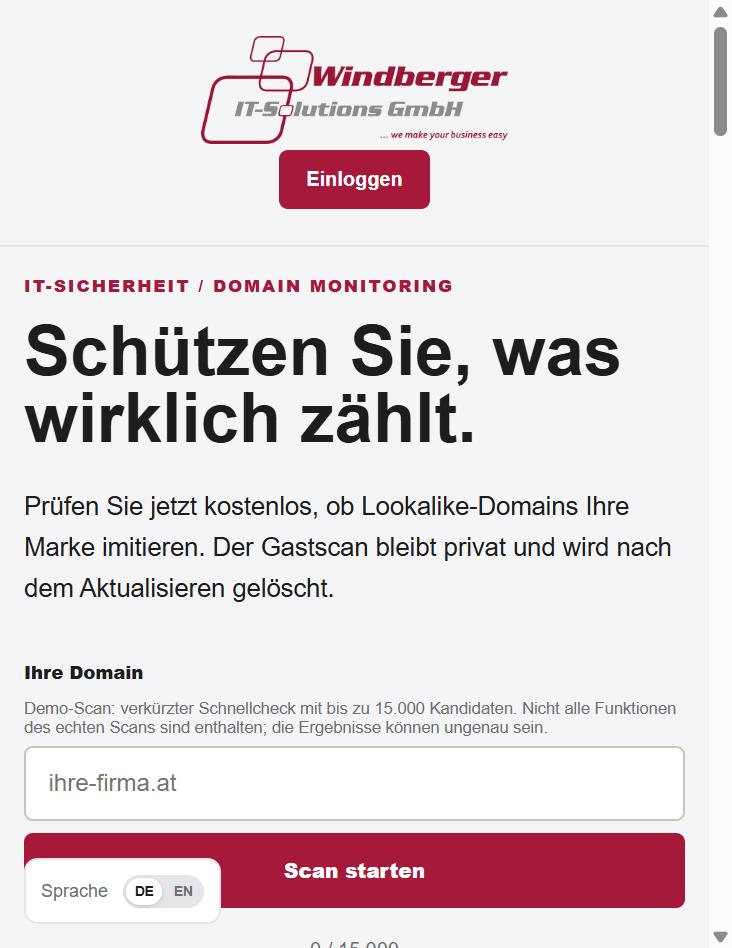
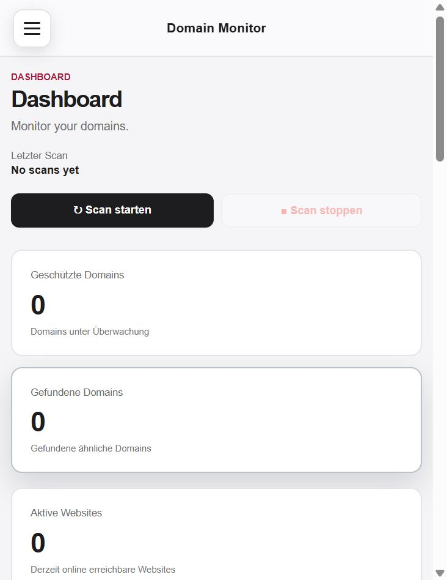

# Domain Monitor

Webanwendung zur Überwachung von Domains. Ein PHP-Frontend verwaltet Benutzer,
Domains und Einstellungen, ein Python-Backend führt die eigentlichen Scans durch
und meldet Auffälligkeiten.

## Screenshots

| Startseite / Gastscan | Dashboard |
|-----------------------|-----------|
|  |  |

## Funktionen

- Benutzerkonten mit Login und Admin-Bereich
- Domain-Scans mit Fortschrittsanzeige
- Gast-Scan ohne Konto
- geschützte, ausgeschlossene und stummgeschaltete Domains
- geplante automatische Scans
- E-Mail-Benachrichtigungen über SMTP (Konfiguration in der Tabelle `app_settings`)
- Threat-Intelligence-Auswertung
- mehrsprachige Oberfläche

## Technik

- Frontend: PHP (PDO), HTML, CSS, JavaScript
- Backend: Python (`scanner.py`, `monitor.py`, Worker-Skripte)
- Datenbank: MySQL

## Aufbau

| Pfad                     | Zweck                                      |
|--------------------------|--------------------------------------------|
| `index.php`              | Einstiegsseite mit Gast-Vorschau und Login |
| `admin.php`              | Admin-Bereich                              |
| `settings.php`           | Einstellungen                              |
| `api/`                   | PHP-Endpunkte (Login, Scans, Domains, …)   |
| `scanner.py`             | Scan-Logik                                 |
| `monitor.py`             | eigenständiger Monitor-Lauf                |
| `*_worker.py`            | Hintergrund-Worker                         |
| `config.py`              | Backend-Konfiguration                      |
| `datenbank-vorlage/`     | Datenbankstruktur (`domain_monitor.sql`)   |
| `css/`, `js/`            | Oberfläche                                 |

## Einrichtung

1. Datenbank anlegen und `datenbank-vorlage/domain_monitor.sql` importieren.
2. Zugangsdaten über Umgebungsvariablen setzen: `DB_HOST`, `DB_PORT`,
   `DB_USER`, `DB_PASSWORD`, `DB_NAME` sowie `PROTECTED_DOMAIN` für die
   überwachte Hauptdomain. Ohne Variablen gelten lokale Standardwerte.
3. Python-Abhängigkeiten installieren: `pip install -r requirements.txt`
4. Frontend über einen PHP-fähigen Server bereitstellen (z. B. XAMPP).
5. Scanner starten: `python scanner.py`

## Zugang

Das mitgelieferte Schema legt einen Admin-Benutzer an:

- Benutzername: `admin`
- Passwort: `changeme`

Das Passwort nach dem ersten Login ändern.
